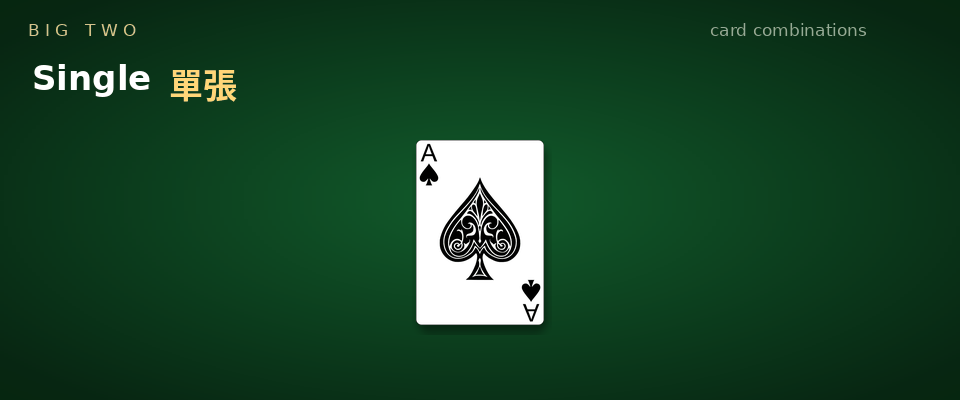
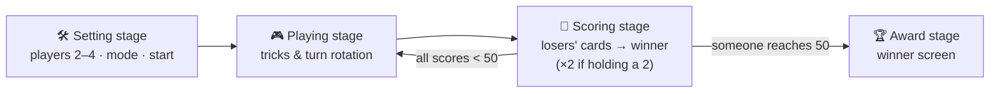
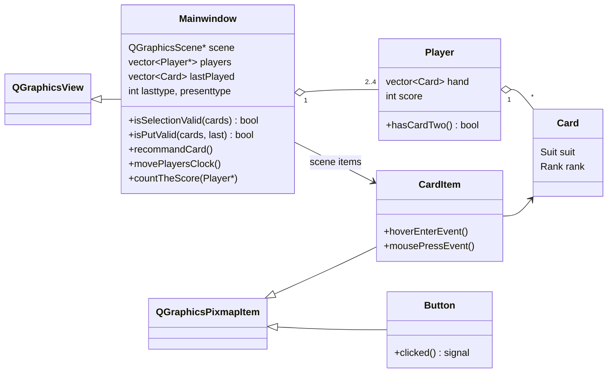

# Big Two — Qt Desktop Card Game


-41CD52?logo=qt&logoColor=white)


A desktop implementation of **Big Two**, written from scratch in **C++ / Qt 5** with a custom rule engine, hot-seat multiplayer for 2–4 players, a hint system, multi-round scoring, sound effects, and a fully mouse-driven table UI.

<p align="center">
  
  <br>
  <sub><i>The six playable combinations, animated with the game's own card art.</i></sub>
</p>

<!-- TODO: record a short gameplay clip (ScreenToGif / LICEcap work well), save it as docs/demo.gif, then uncomment:
<p align="center">
  
</p>
-->

## Features

| | Feature | Where to look |
|---|---------|---------------|
| 🃏 | **Complete rule engine** — classifies any selection as *single / pair / straight / full house / four-of-a-kind / straight flush*, including the special straights `A-2-3-4-5` and `2-3-4-5-6` and the forbidden ones (`J-Q-K-A-2`, `Q-K-A-2-3`, `K-A-2-3-4`) | [`mainwindow.cpp`](bigTwo/mainwindow.cpp) → `isSelectionValid()` |
| ⚖️ | **Legal-move validation** — rank → suit tie-breaking (`2 > A > K > … > 3`, `♠ > ♥ > ♦ > ♣`), plus the *bomb* hierarchy: four-of-a-kind beats any single/pair/straight/full house, straight flush beats everything | `isPutValid()` |
| 👥 | **2 / 3 / 4-player hot-seat mode** — the deal adapts (26 / 17 / 13 cards each) and the whole table **rotates** every turn so the current player always sits at the bottom with their hand face-up | `startplay()`, `movePlayersClock()` |
| 💡 | **Hint engine** — one click searches the sorted hand for the lowest combination that legally beats the last play (singles, pairs, straights incl. edge straights, full houses) and auto-raises those cards | `recommandCard()` |
| 🖱️ | **Interactive cards** — custom `QGraphicsPixmapItem` with hover-lift, click-to-raise selection (max 5 cards) and click feedback sounds | [`carditem.cpp`](bigTwo/carditem.cpp) |
| 🔘 | **Sprite buttons** — reusable image button with hover-state swap, wired through Qt signals/slots | [`button.cpp`](bigTwo/button.cpp) |
| 🏆 | **Multi-round scoring** — winner collects the sum of every loser's remaining cards, **doubled** for any loser still holding a 2; interlude scoreboard between rounds, victory screen at 50 points | `countTheScore()`, `showScore()`, `winGame()` |
| ♣️ | **Proper opening & pass rules** — the first combination of a round must contain the 3♣; passing locks you out for the trick; when everyone else passes, the trick winner leads freely | `playCards2()`, `pass()` |
| 🔊 | **Sound effects** — distinct cues for selecting, playing, passing and illegal moves | `QSound::play()` calls |

## Game flow



## How it's built



A few implementation choices worth noting:

- **Combination types as a lattice.** Every play is tagged with a type id (`0` single … `5` straight flush). `isPutValid()` compares same-type plays by rank-then-suit, and encodes the bomb rules by letting types 4/5 cut across the lattice — so "four-of-a-kind beats any pair" falls out of a single `switch`.
- **Turn rotation by pointer swap.** Instead of tracking a "current seat" everywhere, `movePlayersClock()` rotates the `Player*` pointers themselves. The rendering code only ever draws *player1 at the bottom, face-up* — one perspective, zero per-seat special cases.
- **Immediate-mode scene.** Each turn rebuilds the `QGraphicsScene` (sorted hand, opponents' card backs with count badges, avatars, scores, round counter) from game state, which keeps UI state impossible to desync from game state.
- **Asset pipeline.** All 52 card sprites are preloaded into a `QPixmap*[52]` indexed by `suit offset + rank`, so a `Card` maps to its artwork in O(1).
- **Deterministic opening.** After a time-seeded `std::shuffle`, the 3♣ is moved to the front of the deck so the first hand always contains it — matching the "must open with 3♣" rule.

## Rules quick reference

| Combination | Cards | Notes |
|---|---|---|
| Single 單張 | 1 | rank, then suit decides |
| Pair 對子 | 2 same rank | ♠ in the pair wins ties |
| Straight 順子 | 5 consecutive | `A2345` … `23456`; `JQKA2 / QKA23 / KA234` are illegal |
| Full House 葫蘆 | 3 + 2 | compared by the triple |
| Four of a Kind 鐵支 | 4 + 1 | **bomb** — beats single/pair/straight/full house |
| Straight Flush 同花順 | 5 consecutive, same suit | **top bomb** — beats everything |

Ranks: `2 > A > K > Q > J > 10 > … > 3` · Suits: `♠ > ♥ > ♦ > ♣` · First to **50 points** wins the match.

## Build & run

Requires **Qt 5** (`widgets` + `multimedia` modules) and a C++14 compiler.

```bash
cd bigTwo
qmake && make
./bigTwo          # run from bigTwo/ so the ./dataset asset paths resolve
```

## Project structure

```
bigtwo/
├── bigTwo/
│   ├── main.cpp            # entry point
│   ├── mainwindow.{h,cpp}  # game loop, rule engine, hint engine, rendering
│   ├── player.{h,cpp}      # hand, score, avatar
│   ├── card.{h,cpp}        # Card value type (Suit × Rank enums)
│   ├── carditem.{h,cpp}    # interactive card sprite (hover / select)
│   ├── button.{h,cpp}      # image button with hover states
│   ├── bigTwo.pro          # qmake project
│   └── dataset/            # card art, table backgrounds, UI sprites, sounds
├── README.pdf              # original course README
└── introduction.pdf        # design document (zh-TW)
```

## Authors

- **Ana Liu** ([@12yuuuu](https://github.com/12yuuuu))
- **Donna Hsu**
