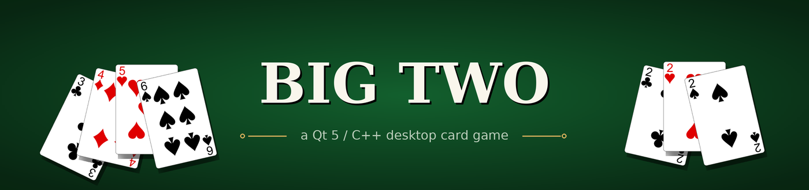
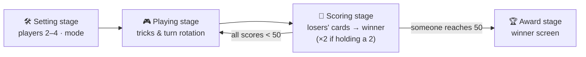
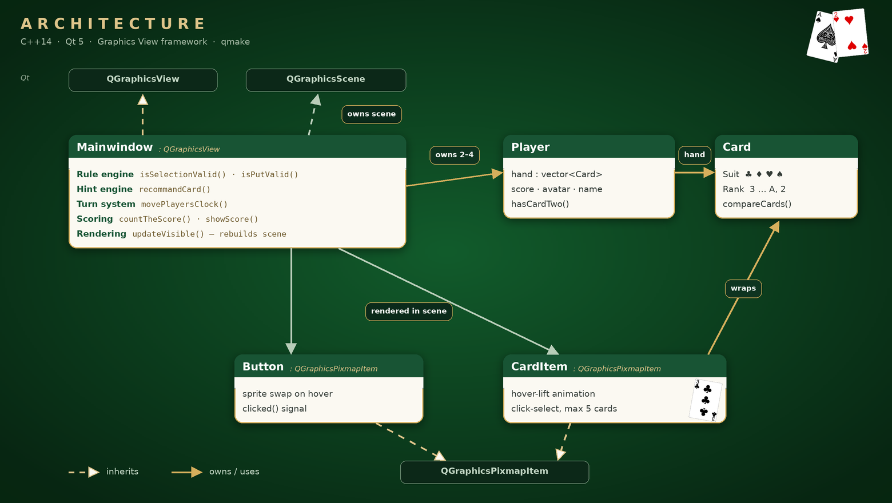

<p align="center">
  
</p>

<p align="center">
  
  
  
  
</p>

A desktop implementation of **Big Two**, the classic Taiwanese climbing card game, written in **C++ / Qt 5**. There is no game framework underneath — every rule, interaction and screen is built directly on Qt's Graphics View scene graph: a hand-rolled rule engine, hot-seat multiplayer for 2–4 players, a hint system, multi-round scoring and sound effects.


<sub><i>The six playable combinations, animated with the game's own card art.</i></sub>

<!-- TODO: record a short gameplay clip (ScreenToGif / LICEcap work well), save it as docs/demo.gif, then uncomment:

-->

## Highlights

- **Complete rule engine.** `isSelectionValid()` classifies any selection as *single / pair / straight / full house / four-of-a-kind / straight flush*, including the special straights `A-2-3-4-5` and `2-3-4-5-6` and rejecting the illegal ones (`J-Q-K-A-2`, `Q-K-A-2-3`, `K-A-2-3-4`).
- **Legal-move validation.** `isPutValid()` compares plays by rank then suit (`2 > A > K > … > 3`, `♠ > ♥ > ♦ > ♣`) and encodes the *bomb* hierarchy — four-of-a-kind beats any single, pair, straight or full house; a straight flush beats everything.
- **2 / 3 / 4-player hot-seat mode.** The deal adapts (26 / 17 / 13 cards each) and the whole table rotates every turn, so the current player always sits at the bottom with their hand face-up.
- **Hint engine.** One click searches the sorted hand for the lowest combination that legally beats the last play and auto-raises those cards.
- **Interactive table.** Custom `QGraphicsPixmapItem` cards with hover-lift and click-to-select (max 5), sprite buttons with hover states, opponents shown as card backs with live count badges.
- **Multi-round scoring.** The round winner collects the sum of every loser's remaining cards — doubled for any loser still holding a 2 — with an interlude scoreboard between rounds and a victory screen at 50 points.
- **Proper trick rules.** The first combination of a round must contain the 3♣; passing locks you out for the trick; once everyone else passes, the trick winner leads freely.

## Gameplay

| Control | Action |
|---|---|
| Hover a card | lifts it out of the hand |
| Click a card | selects / deselects it (up to 5) |
| `Play` | submits the selection — illegal plays bounce back with an error sound |
| `Pass` | skips the trick (you stay out until it ends) |
| `Hint` | auto-selects the lowest combination that beats the last play |

| Combination | Cards | Notes |
|---|---|---|
| Single | 1 | rank, then suit decides |
| Pair | 2 same rank | the ♠ in the pair wins ties |
| Straight | 5 consecutive | `A2345` … `23456`; `JQKA2 / QKA23 / KA234` are illegal |
| Full House | 3 + 2 | compared by the triple |
| Four of a Kind | 4 + 1 | **bomb** — beats single / pair / straight / full house |
| Straight Flush | 5 consecutive, same suit | **top bomb** — beats everything |

First to **50 points** wins the match:



## How it works



### Rule engine

Every play is tagged with a type id (`0` single … `5` straight flush). Same-type plays are compared by rank then suit; the bomb rules fall out of letting types 4 and 5 cut across the hierarchy in a single `switch`. The hint engine reuses the same two validators: `recommandCard()` walks the sorted hand from the bottom and returns the first candidate that passes `isSelectionValid() && isPutValid()`.

### Turn rotation

Instead of tracking a "current seat" everywhere, `movePlayersClock()` rotates the `Player*` pointers themselves. The rendering code only ever draws *player 1 at the bottom, face-up* — one perspective, zero per-seat special cases.

### Rendering

Each turn rebuilds the `QGraphicsScene` from game state (`updateVisible()`): the sorted hand, opponents' card backs with count badges, avatars, scores and the round counter — so the UI can never desync from the game state. All 52 card sprites are preloaded into a `QPixmap*[52]` indexed by `suit offset + rank`, so a `Card` maps to its artwork in O(1). After a time-seeded `std::shuffle`, the 3♣ is moved to the front of the deck so the first hand always contains it — matching the opening rule.

## Build and run

Requires **Qt 5** (`widgets` + `multimedia` modules) and a C++14 compiler.

```bash
cd bigTwo
qmake && make
./bigTwo          # run from bigTwo/ so the ./dataset asset paths resolve
```

## Project structure

| File | Responsibility |
|---|---|
| [`bigTwo/mainwindow.{h,cpp}`](bigTwo/mainwindow.cpp) | game loop, rule engine, hint engine, scoring, scene rendering |
| [`bigTwo/player.{h,cpp}`](bigTwo/player.cpp) | hand, score, avatar, name |
| [`bigTwo/card.{h,cpp}`](bigTwo/card.cpp) | `Card` value type — `Suit` × `Rank` enums |
| [`bigTwo/carditem.{h,cpp}`](bigTwo/carditem.cpp) | interactive card sprite — hover-lift, click-select |
| [`bigTwo/button.{h,cpp}`](bigTwo/button.cpp) | image button with hover states and `clicked()` signal |
| [`bigTwo/main.cpp`](bigTwo/main.cpp) | entry point |
| `bigTwo/dataset/` | card art, table backgrounds, UI sprites, sounds |
| [`README.pdf`](README.pdf) · [`introduction.pdf`](introduction.pdf) | original course docs |

## Tech stack and skills

| | |
|---|---|
| **Language** | C++14 — STL containers & algorithms (`std::sort`, `std::shuffle`, `std::map` frequency counting) |
| **UI** | Qt 5 Widgets + Graphics View framework — custom `QGraphicsItem` subclasses, signals/slots, `QTimer` |
| **Audio** | Qt Multimedia (`QSound`) |
| **Build** | qmake + make |
| **Practices** | rule-engine design, event-driven UI, sprite/asset pipeline, hot-seat state management |

## Known limitations

- Hot-seat PvP only — no computer opponent yet (the hint search would be its natural starting point).
- The hint engine covers singles, pairs, straights and full houses; it won't volunteer a bomb.
- The scene is laid out for a fixed 1920 × 1080 table.

## Authors

Built for *Introduction to Computer Science* at NCKU by

- **Ana Liu** ([@12yuuuu](https://github.com/12yuuuu))
- **Donna Hsu**
